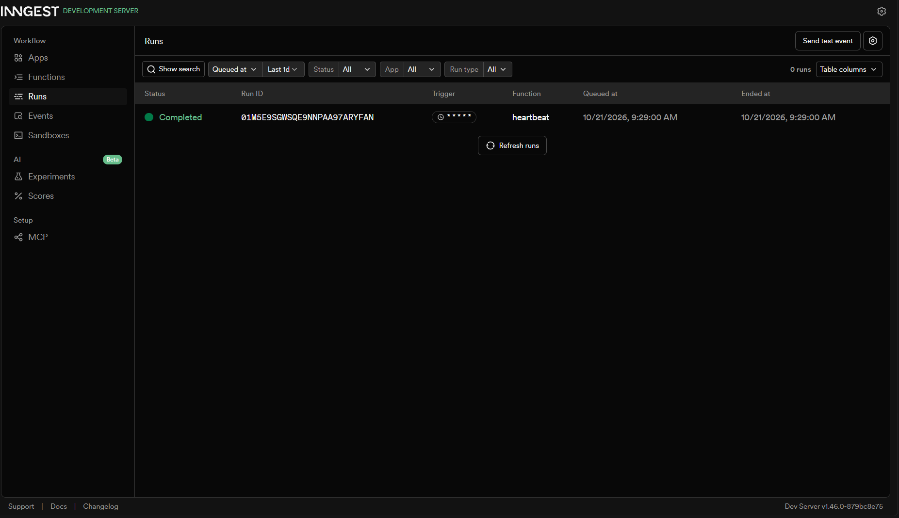

# Your First Background Job

A small Express API whose slow work runs in a background job. The endpoint answers instantly, a status endpoint reports progress, and a cron job runs on the clock alone. Background jobs, retries and cron are handled by [Inngest](https://www.inngest.com/), with every run visible in its local dashboard.

Built for the FlyRank Internship, Backend Track, Week 4, Assignment A7.

**The pattern:** accept fast, work in the background, report status.

```
client ── POST /reports ──► API: save "pending", send event, reply 202 (milliseconds)
                              │
                              └─ event: report/requested ─► Inngest ─► make-report (8 s of work)
                                                                          │
client ── GET /reports/:id ◄── status: pending ... done + result ◄────────┘

clock ── every minute ─────────────────────────────────────► heartbeat (logs a summary)
```

---

## Tech stack

- Node.js 18+ (ES modules, so `package.json` has `"type": "module"`)
- Express
- Inngest (client, functions, Dev Server)
- Language lane: **JavaScript**

## How to run

You need two terminals, and both stay open.

**Install once:**

```bash
npm install
```

**Terminal 1: the API (port 3000)**

```bash
node index.js
```

**Terminal 2: the Inngest Dev Server (dashboard at http://localhost:8288)**

```bash
npx inngest-cli@latest dev -u http://localhost:3000/api/inngest
```

Open http://localhost:8288 to see functions, runs, steps and retries. No account or credit card is needed.

### Quick try

```bash
# 1. Ask for a report (answers instantly with 202)
curl -i -X POST http://localhost:3000/reports \
  -H "Content-Type: application/json" \
  -d '{"topic":"cats"}'

# 2. Poll the status (pending first, done after ~8 seconds)
curl -i http://localhost:3000/reports/<id>
```

---

## Endpoints

| Method | Path | Description | Responses |
|--------|------|-------------|-----------|
| GET | `/health` | Health check, returns `{ "status": "ok" }` | `200` |
| POST | `/reports` | Body `{ "topic": "cats" }`. Saves a `pending` report, sends the `report/requested` event, returns at once | `202` with `{ id, status: "pending" }`, `400` if `topic` is missing |
| GET | `/reports/:id` | Status endpoint: `pending`, then `done` with the result | `200`, `404` for an unknown id |
| ANY | `/api/inngest` | Inngest serve endpoint, where the Dev Server finds the functions | n/a |

## Inngest functions

| Function id | Trigger | What it does |
|-------------|---------|--------------|
| `say-hello` | Event `test/hello` | Sleeps 5 seconds (`step.sleep("wait-a-bit", "5s")`), returns "Hello from the background!". Used to verify the Inngest connection. |
| `make-report` | Event `report/requested` | Step 1: `step.sleep("do-the-slow-work", "8s")`. Step 2: `step.run("build-report", ...)` builds the result string (`Report successfully generated for topic: <topic>`); the function then saves it in the map with `status: "done"`. Throws "The report oven is broken!" when the topic is `fail`. Configured with `retries: 2`. |
| `heartbeat` | Cron `* * * * *` (every minute, for testing) | Logs one line like `[Heartbeat] Summary: 1 pending, 2 done, 0 failed` from a `log-summary` step. No request or event involved. |

---

## Proof: 202 now, done later

**POST answers in milliseconds with 202:**

```
$ time curl -i -X POST http://localhost:3000/reports -H "Content-Type: application/json" -d '{"topic":"cats"}'
```

> Paste your real output here: the `HTTP/1.1 202 Accepted` line, the JSON body with the id, and the `real` time from `time`.

**Poll right away (pending):**

> Paste your real `GET /reports/<id>` output showing `"status": "pending"`.

**Poll about 10 seconds later (done):**

> Paste your real `GET /reports/<id>` output showing `"status": "done"` and the result.

## Dashboard screenshot



The screenshot shows all three functions: a completed `make-report` run with its steps, a failed run with its retries, and the `heartbeat` cron runs.

---

## Stage 3: retries vs. validation

A request with a missing `topic` is rejected at the door with `400` and never creates a job, because a wrong input will be wrong every time and retrying cannot fix it, while a failure like a dropped network connection is a wrong moment, which a retry can fix.

To see retries, `POST /reports` with `{"topic":"fail"}`. The `build-report` step throws "The report oven is broken!", and the dashboard shows attempt 1, then attempt 2, then attempt 3 (with growing waits, which is called backoff) before the run ends **Failed**.

## Stage 4: cron expressions

A cron expression has five fields: minute, hour, day-of-month, month, day-of-week.

- **Every day at 08:00:** `0 8 * * *`
- **Every Sunday at 22:00:** `0 22 * * 0`
